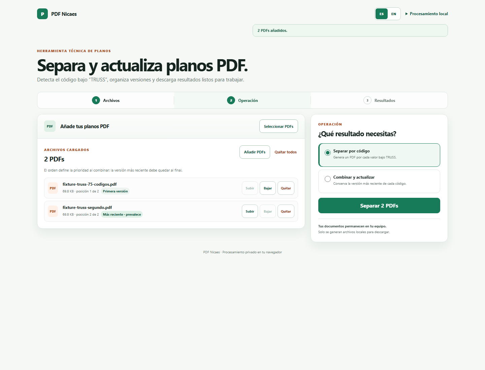
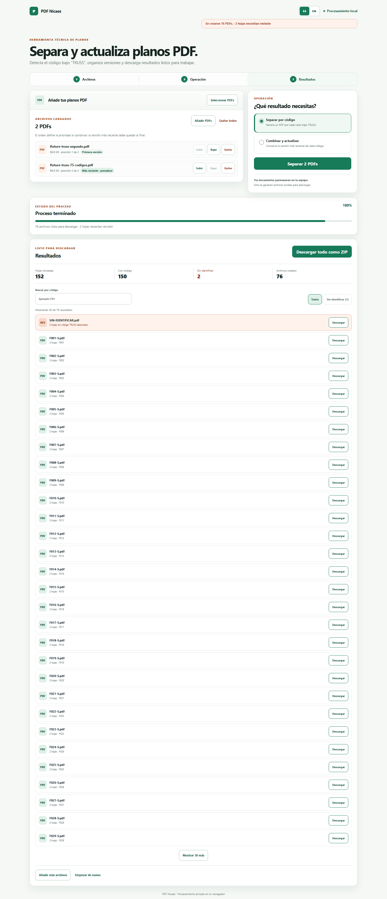
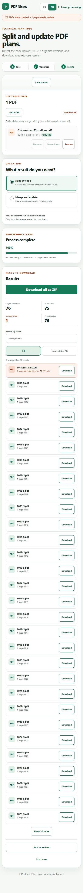
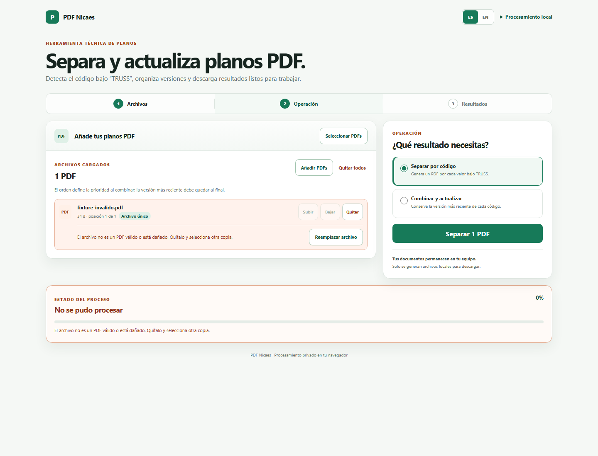
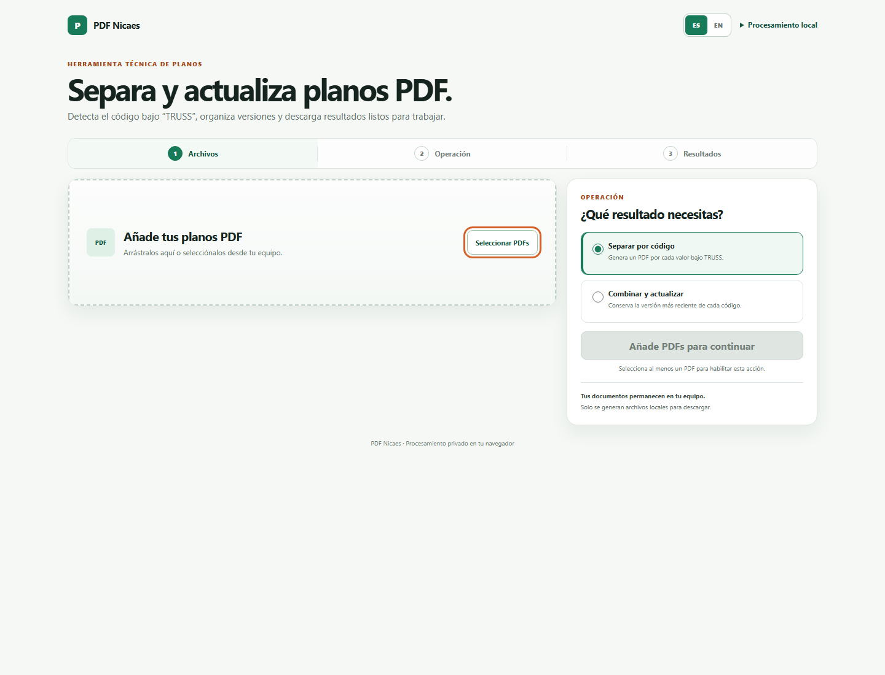

# Verificación de la primera ronda de mejoras

Fecha: 20 de agosto de 2026
Alcance: cargar, ordenar, quitar, separar, combinar, descargar, reiniciar, error, móvil y teclado.

## Resultado

La primera ronda quedó verificada sin errores de consola en escritorio ni móvil.

- Dos archivos se cargaron y reordenaron correctamente.
- Un archivo pudo quitarse y volver a añadirse.
- Un duplicado fue ignorado sin borrar resultados existentes.
- `Separar por código` produjo `F01-S.pdf`, `SIN-IDENTIFICAR.pdf` y `F02-S.pdf`.
- El resumen mostró 26 hojas revisadas, 24 con código, 2 sin identificar y 3 archivos creados.
- `F01-S.pdf` se descargó correctamente.
- `Combinar todos` produjo y descargó `todos-los-pdfs.pdf` con 14 hojas.
- “Procesar otros PDFs” reinició correctamente archivos y resultados.
- El archivo inválido mostró el mismo mensaje específico y en español tanto en el aviso como en el estado persistente.
- A 390 px no apareció desplazamiento horizontal.
- La zona de carga y la acción principal mostraron foco visible de 3 px mediante teclado.

## Evidencia

### Archivos cargados y ordenables

### Resultados explicables

### Resultados en móvil

### Error recuperable

### Foco de teclado

## Pendiente para las siguientes rondas

- Revisión completa de códigos y duplicados antes de generar archivos.
- Cancelación real durante lectura u OCR.
- Dependencias PDF/OCR empaquetadas localmente para uso sin Internet.
- Pruebas con lector de pantalla, zoom 200–400 %, PDFs cifrados, escaneados y de cientos de páginas.
